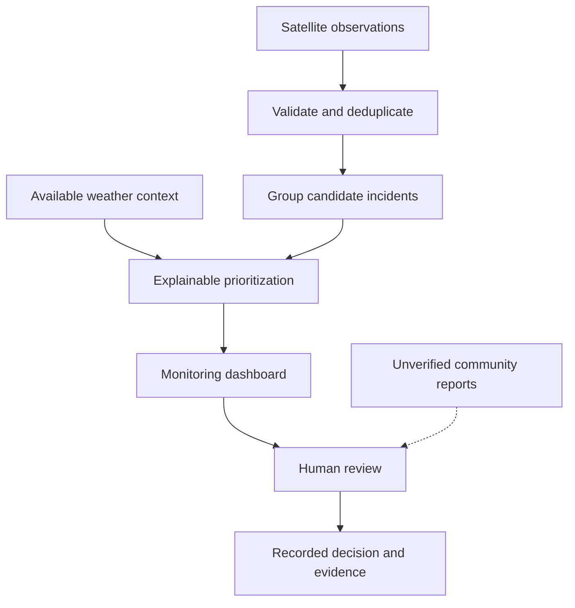

# Wildfire Detection System

**Satellite observations. Environmental context. Informed review.**

A wildfire-monitoring project that explores how satellite fire detections, weather conditions, and community observations can help people review potential wildfire activity.

**Python · Geospatial Data · Environmental Monitoring**

[Overview](#overview) · [Project Scope](#project-scope) · [Development Roadmap](#development-roadmap) · [Attribution](#attribution)

---

## Overview

The **Wildfire Detection System** began as a collaborative prototype developed by **Aaron Johnson and Clinton Osawe**. The original idea combined satellite fire observations from NASA's Fire Information for Resource Management System (FIRMS), weather information, and an exploratory SMS confirmation workflow.

This repository documents the next stage of that idea: developing a reproducible application that organizes observations, highlights incidents worth reviewing, and records the evidence behind each decision.

The goal is to make potential wildfire activity easier to investigate while keeping the distinction between a satellite detection, an automated priority score, and a human assessment clear.

> **Project status:** Prototype redevelopment. This README establishes the scope and delivery plan; roadmap items are not claims of completed functionality. Implementation status will be updated as features are added and verified in this repository.

## The Problem

A satellite thermal anomaly is a useful signal, but it does not establish that an uncontrolled wildfire is occurring. Reviewing potential incidents requires context: where and when an observation was recorded, whether other detections are nearby, what environmental conditions are available, and what evidence supports a follow-up decision.

This project explores a workflow for bringing those pieces together in one place.

## Project Scope

### Initial development target

The first release will focus on a **local, reproducible monitoring and review application**.

| Area | Intended capability |
| :--- | :--- |
| **Observation ingestion** | Import satellite observation CSV files, validate required fields, and identify duplicate records. |
| **Geographic grouping** | Organize nearby observations into candidate incidents using documented distance and time rules. |
| **Incident prioritization** | Provide an explainable priority score with visible contributing factors and missing-data indicators. |
| **Monitoring interface** | Display incident locations, observation times, supporting evidence, and review status. |
| **Human review** | Record decisions and notes through a defined incident-review workflow. |
| **Persistent records** | Preserve observations and review history between sessions. |
| **Reproducible demonstration** | Include clearly labeled synthetic data so the project can be explored without paid services or credentials. |

### Future extensions

After the initial workflow is implemented and tested, potential extensions include:

- Scheduled NASA FIRMS ingestion with error handling and source timestamps.
- Weather enrichment with documented units, freshness checks, and provenance.
- Community reports kept separate from verified evidence.
- Opt-in notifications with consent, unsubscribe support, and delivery tracking.
- Machine-learning experiments supported by labeled data and a documented evaluation process.

### Outside the initial scope

The first release will not provide emergency dispatch, evacuation guidance, wildfire-spread forecasts, automatic image verification, or a publicly deployed multi-user service. It will not claim validated detection accuracy or replace official emergency information.

## Proposed Workflow

**Detection** means a source observation has been recorded. **Priority** indicates which observations may deserve attention first. **Review status** records an operator's assessment; it is not independent proof that a wildfire exists.

## Technical Direction

| Component | Proposed approach | Purpose |
| :--- | :--- | :--- |
| Application logic | Python | Ingestion, validation, grouping, and prioritization |
| Local persistence | SQLite | Store observations, incidents, and review history |
| Browser interface | HTML, CSS, and JavaScript | Present incidents and support review |
| Data exchange | CSV and GeoJSON | Support reproducible imports and geographic exports |
| Quality checks | Automated tests and GitHub Actions | Verify behavior and catch regressions |

The original prototype explored Pandas, scikit-learn, K-means clustering, weather API requests, and SMS requests. Those experiments inform the redevelopment, but they do not establish an integrated or production-ready system.

K-means groups similar records; its cluster labels do not inherently identify wildfires. Any future predictive model will require independently labeled examples, suitable evaluation splits, and reported limitations before accuracy claims are made.

## Development Roadmap

| Milestone | Deliverable | Completion criteria |
| :--- | :--- | :--- |
| **01 · Foundation** | Scope, attribution, and development plan | Project goals and boundaries are documented. |
| **02 · Data pipeline** | Validated imports and duplicate handling | Valid fixtures import; malformed records are rejected with useful errors. |
| **03 · Incident logic** | Geographic grouping and transparent scoring | Distance/time rules and score components have automated tests. |
| **04 · Review workflow** | Persistent incidents, decisions, and notes | Allowed status transitions are enforced and survive restarts. |
| **05 · Dashboard** | Incident exploration and geographic export | A user can inspect evidence, record a review, and export results. |
| **06 · Release readiness** | Setup instructions, CI, and documented limitations | A fresh checkout runs using the documented steps and passes its tests. |

Milestones represent planned increments. Completion should be supported by the code, tests, and review history in this repository.

## Development Practices

- **Track work with issues:** Define the problem, scope, and acceptance criteria before implementation.
- **Use focused branches:** Keep each change small enough to review and explain.
- **Review through pull requests:** Link the relevant issue and describe the behavior changed and verification performed.
- **Test meaningful behavior:** Cover invalid data, duplicate imports, grouping boundaries, persistence, and review transitions.
- **Document decisions:** Record important architectural choices and their tradeoffs.
- **Protect credentials:** Keep API keys and personal contact information out of source control. Revoke any credentials previously exposed in prototype code.

A feature is complete when its acceptance criteria are met, relevant tests pass, documentation reflects its behavior, and known limitations are recorded.

## Running the Project

This foundation README does not yet define a verified startup command for the evolving repository. Environment requirements, installation steps, sample-data instructions, and a demonstration walkthrough will be added alongside the runnable implementation.

Sample observations will be clearly marked as synthetic. Live data will be identified by its source and observation time.

## Attribution

The original **Wildfire Detection System** concept and prototype were jointly developed by:

- **Clinton Osawe**
- **[Co-author name — replace before publishing]**

The redevelopment builds on that shared work. Individual contributions should be described accurately as implementation progresses, with the original collaboration acknowledged.

AI assistance has been used to help draft documentation and explore a reference implementation. Contributors remain responsible for reviewing, understanding, testing, and accurately describing code they incorporate.

**Data source:** [NASA FIRMS](https://firms.modaps.eosdis.nasa.gov/). Refer to the [VIIRS field descriptions](https://firms.modaps.eosdis.nasa.gov/content/descriptions/FIRMS_VIIRS_Firehotspots.html) when interpreting observations. This project is independent and is not affiliated with or endorsed by NASA.

## License

A license has not yet been selected. The original contributors should agree on licensing before a `LICENSE` file is added. Public availability alone does not grant an open-source license.

---

**Built to make wildfire observations easier to inspect, understand, and review.**

