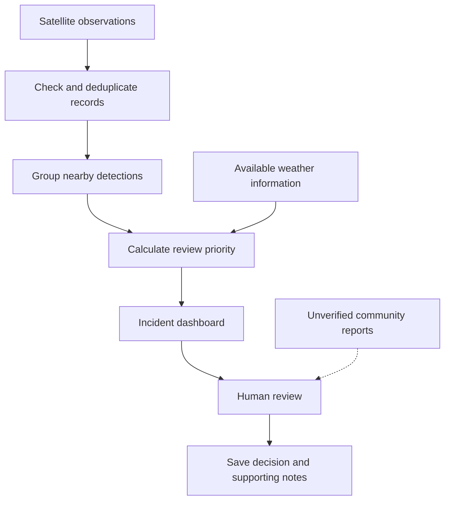

# Wildfire Detection System

**Making satellite fire observations easier to understand and investigate.**

Exploring how satellite data, weather conditions, and community observations can support wildfire monitoring.

**Python · Geospatial Data · Environmental Monitoring**

[About](#about-the-project) · [Scope](#project-scope) · [Roadmap](#development-roadmap) · [Acknowledgments](#attribution-and-acknowledgments)

---

## About the Project

I developed the **Wildfire Detection System** as part of a project in my role as a **Software Engineering Research Assistant**, with credit to **Professor Sukhjit Singh Sehra**.

The idea started with a question: **how can we make satellite fire observations more useful to the people reviewing them?** A detection gives us a location and a time, but understanding what might be happening on the ground takes more context.

The initial prototype explored bringing together observations from NASA's Fire Information for Resource Management System (FIRMS), local weather information, and an SMS-based approach to requesting nearby observations. This repository builds on that idea, with a focus on organizing the data, making potential incidents easier to inspect, and keeping a clear record of review decisions.

> **Currently in development:** The scope and roadmap below describe the application I'm working toward. Features will be marked complete as their implementation and tests are added to this repository.

## Why This Project?

Satellite observations can point us toward potential fire activity, but a thermal anomaly alone does not tell the whole story. Nearby detections may belong to the same event, weather information may be missing or outdated, and a report from someone nearby still needs to be assessed.

I want this project to make that review process easier to follow. Someone looking at an incident should be able to see where the data came from, why it was prioritized, and what evidence informed the next decision.

## Project Scope

### The first version

The first goal is a local application that can be run and explored using sample data, without needing paid services or API credentials.

| Feature | What it will help users do |
| :--- | :--- |
| **Import observations** | Load satellite observation CSV files, catch invalid records, and avoid importing duplicates. |
| **Group nearby detections** | Bring observations close in location and time together into candidate incidents. |
| **Understand priority** | See which incidents may deserve attention first and which factors contributed to their scores. |
| **Explore incidents** | View locations, observation times, available context, and review status in a dashboard. |
| **Record a review** | Add notes, update an incident's status, and revisit the reasoning behind a decision. |
| **Keep a history** | Save observations and review activity between sessions. |
| **Try a reproducible demo** | Explore the workflow with clearly labeled synthetic observations. |

### Ideas for later versions

Once the core workflow is working and tested, I'd like to add:

- Scheduled imports from NASA FIRMS, with visible source timestamps and handling for failed requests.
- Weather information that includes its source, units, and observation time.
- Community reports that remain clearly marked as unverified until reviewed.
- Opt-in notifications with consent and unsubscribe support.
- Machine-learning experiments evaluated against labeled examples.

### Where the scope stops

This is a research and software-development project. The first version is not intended for emergency dispatch, evacuation advice, wildfire-spread forecasting, or automatic verification of photos. It does not replace official emergency information.

A priority score will help organize the review queue; it will not represent a validated probability that a wildfire exists.

## How the Pieces Fit Together

The planned workflow starts with satellite observations and ends with a recorded human review. Weather and community reports provide additional context as those integrations are developed.

Three distinctions matter throughout the project:

- A **detection** is an observation recorded by a data source.
- A **priority score** helps decide what to inspect first.
- A **review status** records a person's assessment of the available evidence.

Keeping these separate makes it easier to understand what the system knows and what still needs investigation.

## Technical Approach

| Part of the application | Planned technology | Why it fits |
| :--- | :--- | :--- |
| Data processing and incident logic | Python | A practical foundation for validation, geographic calculations, and data analysis. |
| Local storage | SQLite | Keeps observations and review history together without a separate database server. |
| Dashboard | HTML, CSS, and JavaScript | Provides a browser interface for exploring incidents and recording decisions. |
| Import and export | CSV and GeoJSON | Makes sample data easy to inspect and geographic results easy to reuse. |
| Automated checks | Python tests and GitHub Actions | Helps catch regressions as the project grows. |

The original prototype explored Pandas, scikit-learn, K-means clustering, weather API requests, and SMS requests. That work provides a starting point for the next version.

One lesson from those experiments is that grouping similar records is different from identifying a real wildfire. K-means can reveal patterns, but its cluster labels do not establish detection accuracy. Before making predictive claims, I plan to use labeled data, compare against simple baselines, and document where a model performs poorly.

## Development Roadmap

I'm organizing the work into small milestones so each part can be tested and explained before adding the next.

| Milestone | Focus | What completion looks like |
| :--- | :--- | :--- |
| **01 · Foundation** | Project scope and attribution | The purpose, boundaries, and development plan are documented. |
| **02 · Data imports** | Validation and duplicate handling | Sample files import correctly, and invalid records produce useful errors. |
| **03 · Incident logic** | Geographic grouping and priority scores | Grouping rules and score calculations are covered by tests. |
| **04 · Review workflow** | Saved incidents, notes, and decisions | Valid status changes are enforced and remain available after a restart. |
| **05 · Dashboard** | Incident exploration and export | A user can inspect evidence, record a review, and export geographic results. |
| **06 · First release** | Setup guide, automated checks, and demo | A fresh checkout runs using the documented steps and passes its tests. |

These are planned milestones. The repository's code, tests, and pull requests will show the progress behind each one.

## How I'm Managing the Work

- **Start with an issue.** Describe the problem, keep the scope manageable, and define how the result will be checked.
- **Keep changes focused.** Use branches and commits that each have a clear purpose.
- **Review before merging.** Explain what changed, link the issue, and record the checks performed in the pull request.
- **Test the awkward cases.** Include missing fields, duplicate records, grouping boundaries, and invalid review transitions.
- **Write down decisions.** Explain important design choices and the tradeoffs behind them.
- **Keep credentials private.** Exclude API keys and personal contact information from version control, and revoke any previously exposed keys.

I consider a feature finished when it meets its acceptance criteria, its relevant tests pass, and the documentation explains its behavior and limitations.

## Getting Started

Setup instructions will be added alongside the runnable implementation. They will cover the Python version, installation steps, sample data, and a short walkthrough of the review workflow.

The demo will use clearly labeled synthetic observations. Any live-data integration will show the source and observation time so that sample, historical, and current data are easy to distinguish.

## Attribution and Acknowledgments

**Project developer:** Clinton Osawe  
**Project context:** Software Engineering Research Assistant project  
**Academic acknowledgment:** Professor Sukhjit Singh Sehra

This project was developed as part of my work as a Software Engineering Research Assistant. I would like to acknowledge **Professor Sukhjit Singh Sehra** in connection with that work.

The satellite-data component draws on **[NASA FIRMS](https://firms.modaps.eosdis.nasa.gov/)**. NASA's [VIIRS field descriptions](https://firms.modaps.eosdis.nasa.gov/content/descriptions/FIRMS_VIIRS_Firehotspots.html) explain the observation fields used by the project. This is an independent project and is not affiliated with or endorsed by NASA.

AI tools have helped with documentation and exploring a reference implementation. Any code incorporated into this repository needs to be reviewed, understood, and tested as part of development.

## License

A license has not yet been selected. A `LICENSE` file will be added once the appropriate permissions and terms have been agreed upon.

---

**A research project built around clearer data, thoughtful review, and practical software engineering.**

